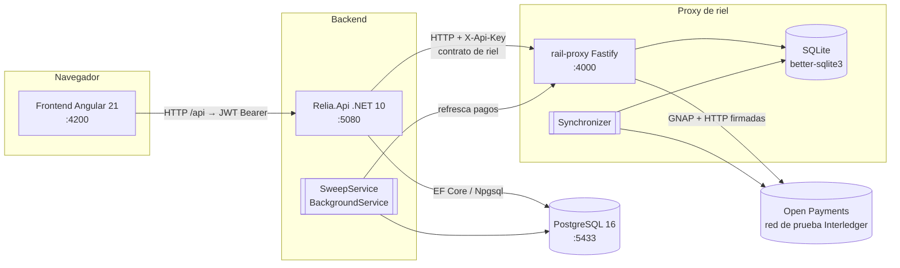
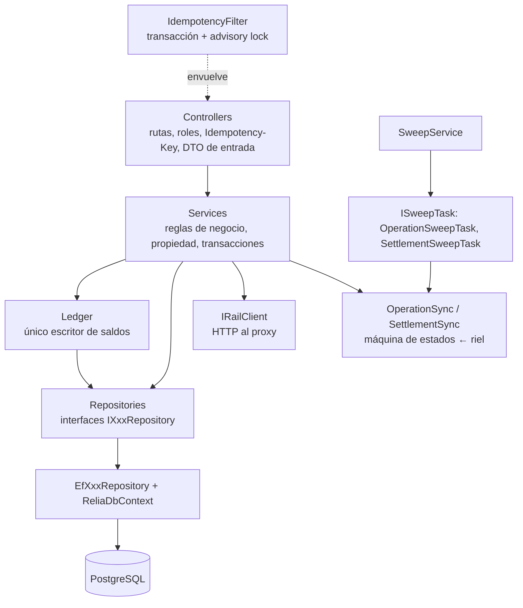
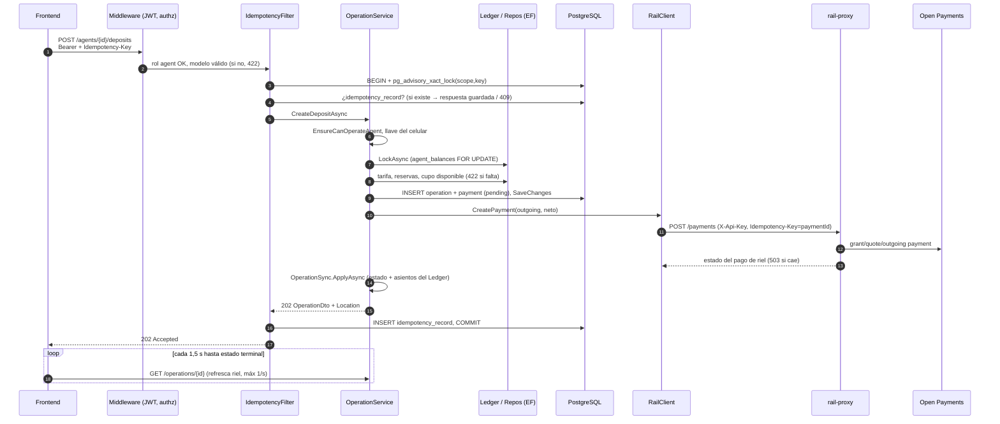
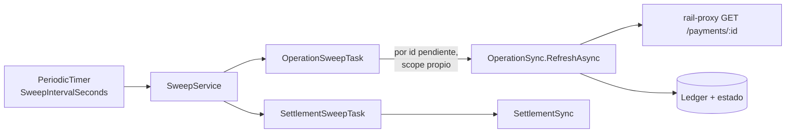
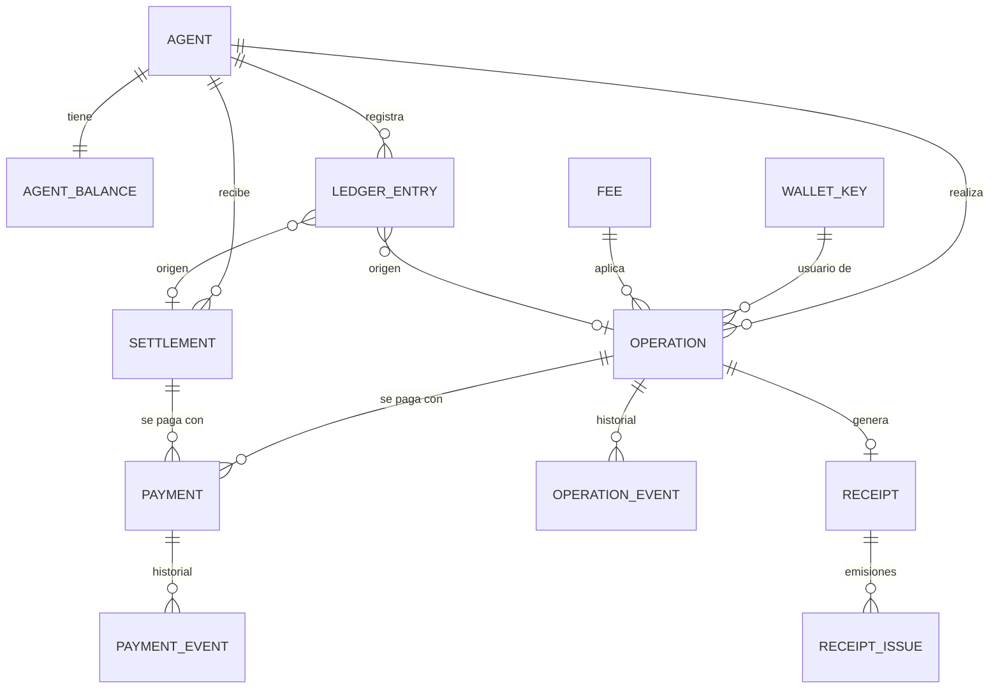
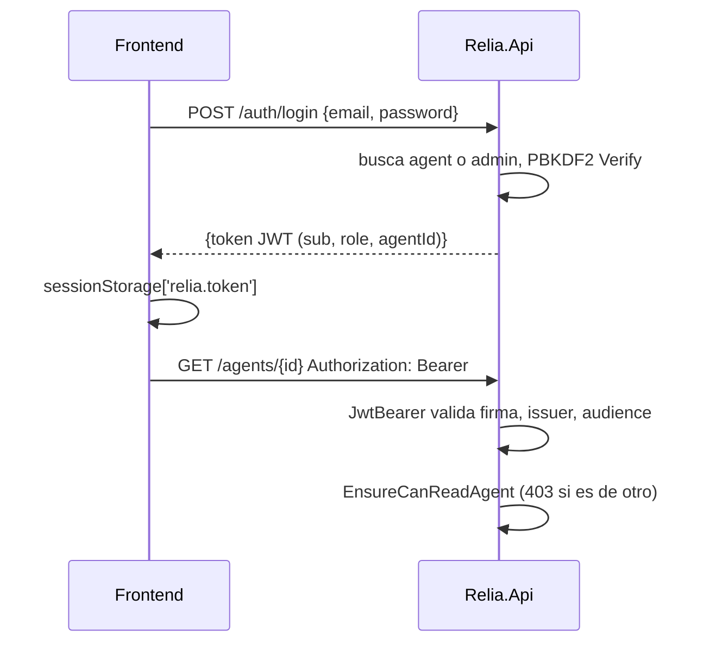

# Arquitectura de Relia

> Documento técnico generado a partir del código del repositorio (rama `feature/ai_usage`, octubre 2026).
> Cada sección distingue **[Existente]** (lo que hay en el código) de **[Recomendación]** (propuesta, no implementada).

## 1. Descripción general

Relia convierte comercios de barrio (**corresponsales**, `agent`) en puntos de efectivo digital: el usuario entrega o recibe efectivo en la tienda y el dinero se mueve por un riel de pagos (hoy Open Payments / Interledger en la red de prueba). Relia orquesta el **cupo**, la **caja** (efectivo), las **comisiones** y su **liquidación** al corresponsal. Vocabulario canónico: [GLOSSARY.md](../GLOSSARY.md).

Responsabilidades del sistema [Existente]:

| Capacidad | Ruta principal | Dónde |
|---|---|---|
| Login de corresponsal y admin, sesión `/me` | `POST /auth/login` | [AuthController.cs](../backend/API/Controllers/AuthController.cs), [AuthService.cs](../backend/API/Services/AuthService.cs) |
| Saldos, historial y ajustes de efectivo | `/agents/{id}`, `/history`, `/cash-adjustments` | [AgentsController.cs](../backend/API/Controllers/AgentsController.cs) |
| Desglose, depósito, retiro, carga de cupo | `/agents/{id}/operations/preview`, `/deposits`, `/withdrawals`, `/quota-top-ups` | [OperationService.cs](../backend/API/Services/OperationService.cs) |
| Cancelación y entrega de efectivo | `/operations/{id}/cancel`, `/cash-handover` | [OperationsController.cs](../backend/API/Controllers/OperationsController.cs) |
| Llaves (celular → payment pointer), invitación y vinculación con OTP | `/keys/{phone}`, `/key-links` | [KeyService.cs](../backend/API/Services/KeyService.cs), [KeyLinkService.cs](../backend/API/Services/KeyLinkService.cs) |
| Recibos | `/operations/{id}/receipt` | [ReceiptService.cs](../backend/API/Services/ReceiptService.cs) |
| Liquidación de comisiones (admin) | `/agents/{id}/settlements`, `/settlements` | [SettlementService.cs](../backend/API/Services/SettlementService.cs) |
| Modo demo (fallos forzados, vencer, reinicio, Bre-B simulado, bandeja SMS/WhatsApp) | `/demo/*` | [DemoController.cs](../backend/API/Controllers/DemoController.cs) |

Contratos: [contracts/relia-api.openapi.yaml](../contracts/relia-api.openapi.yaml) (frontend ↔ backend) y [contracts/rail-proxy.openapi.yaml](../contracts/rail-proxy.openapi.yaml) (backend ↔ proxy). Flujos de negocio: [contracts/FLUJOS.md](../contracts/FLUJOS.md).

## 2. Stack tecnológico [Existente]

| Pieza | Lenguaje / runtime | Frameworks y dependencias principales | Fuente |
|---|---|---|---|
| **Backend** (`Relia.Api`) | C#, .NET 10 (`net10.0`), nullable habilitado | ASP.NET Core MVC (controllers), `Microsoft.AspNetCore.Authentication.JwtBearer` 10.0.11, `Microsoft.AspNetCore.OpenApi` 10.0.11, `Npgsql.EntityFrameworkCore.PostgreSQL` 10.0.3, `Swashbuckle.AspNetCore.SwaggerUI` 10.3.0 | [Relia.Api.csproj](../backend/API/Relia.Api.csproj) |
| **Base de datos** | PostgreSQL 16 (Docker) | DDL SQL con enums, vistas, triggers/checks | [docker-compose.yml](../backend/docker-compose.yml), [db_ddl.sql](../backend/db/db_ddl.sql) |
| **Rail proxy** | TypeScript ~5.9, Node ≥ 22.12, ESM | Fastify ^5.12, `@fastify/rate-limit` ^11, `@interledger/open-payments` ^7.4, `better-sqlite3` ^12, pino ^10; `tsx` en desarrollo | [rail-proxy/package.json](../rail-proxy/package.json) |
| **Frontend** | TypeScript ~5.9 | Angular ^21 (standalone, signals), PrimeNG ^21 + `@primeuix/themes`, RxJS ~7.8, Zod ^4, `qrcode`; pruebas con Vitest ^4 + jsdom | [frontend/relia/package.json](../frontend/relia/package.json) |
| **Orquestación local** | bash | Arranca proxy → Postgres → backend → frontend | [dev.sh](../dev.sh) |

## 3. Arquitectura

### 3.1 Vista de contenedores



La decisión central está en el [ADR 0001](adr/0001-proxy-como-contrato-de-riel.md): el backend **no** conoce Open Payments. Le pide al proxy operaciones de negocio agnósticas al riel (pagar a un pointer, cobrar a un pointer, consultar, cancelar). El proxy es el **adapter** en esa seam; un futuro adaptador Bre-B implementaría el mismo contrato OpenAPI. Hoy hay **un solo adapter real** (Open Payments); el Bre-B de la carga de cupo y las billeteras simuladas se resuelven *dentro del backend*, no como un segundo adapter del contrato.

### 3.2 Capas del backend [Existente]



| Capa | Responsabilidad | Archivos |
|---|---|---|
| Controllers | Mapear rutas del contrato, `[Authorize(Roles=…)]`, `[Idempotent]`, validación de modelo, códigos 201/202 + `Location` | [Controllers/](../backend/API/Controllers/) |
| Contracts | DTOs de entrada/salida del OpenAPI | [Dtos.cs](../backend/API/Contracts/Dtos.cs) |
| Services | Lógica de negocio por grupo de rutas; reglas de rol/propiedad con `ICurrentUser`; errores como `ApiException` con `code` | [Services/Abstractions.cs](../backend/API/Services/Abstractions.cs) |
| Dominio | Entidades y enums | [Entities.cs](../backend/API/Domain/Entities.cs), [Enums.cs](../backend/API/Domain/Enums.cs) |
| Repositorios | Interfaces de acceso a datos + implementación EF | [Repositories/Abstractions.cs](../backend/API/Repositories/Abstractions.cs), [EfRepositories.cs](../backend/API/Repositories/EfRepositories.cs) |
| Persistencia | `ReliaDbContext`, mapeo de enums Postgres, siembra de demo | [ReliaDbContext.cs](../backend/API/Persistence/ReliaDbContext.cs), [DemoSeeder.cs](../backend/API/Persistence/DemoSeeder.cs) |
| Riel | Cliente HTTP tipado del proxy | [RailClient.cs](../backend/API/Rail/RailClient.cs) |
| Transversal | Errores problem+json, idempotencia, auth, opciones | [ApiErrors.cs](../backend/API/Errors/ApiErrors.cs), [IdempotencyFilter.cs](../backend/API/Idempotency/IdempotencyFilter.cs), [Auth/](../backend/API/Auth/), [Options.cs](../backend/API/Configuration/Options.cs) |

### 3.3 Patrones de diseño [Existente]

- **Inyección de dependencias** del contenedor de ASP.NET Core; todo se registra en [Program.cs](../backend/API/Program.cs). Servicios y repositorios `Scoped`; `JwtTokenIssuer`, `DemoFaults`, `RailRefreshThrottle` y `TimeProvider` `Singleton`.
- **Repository + Unit of Work**: `IUnitOfWork.InTransactionAsync` abre una transacción o se une a la ya abierta (p. ej. la del filtro de idempotencia) — [EfRepositories.cs:12](../backend/API/Repositories/EfRepositories.cs#L12).
- **Ledger como módulo profundo**: `ILedger` tiene dos métodos (`LockAsync`, `Post`) y es el *único* lugar que cambia `agent_balances` y escribe `ledger_entries`, con antes/cambio/después — [Ledger.cs](../backend/API/Services/Ledger.cs). La base revalida los signos (`ck_ledger_signs`).
- **Bloqueo pesimista**: `SELECT … FOR UPDATE` sobre saldos, operaciones, pagos, desafíos OTP y liquidaciones (`Get…ForUpdateAsync`).
- **Idempotencia** por filtro de acción (`[Idempotent]`): alcance método+ruta+actor, huella SHA-256 de los argumentos, `pg_advisory_xact_lock`, se guardan solo respuestas 2xx — [IdempotencyFilter.cs](../backend/API/Idempotency/IdempotencyFilter.cs).
- **Máquina de estados sincronizada con el riel**: `OperationSync` / `SettlementSync` aplican lecturas del proxy a la operación; se invocan en la lectura (`GET /operations/{id}`, con throttle de 1 vez/s) y en el barrido de fondo.
- **Background worker** con `PeriodicTimer` y tareas pluggables `ISweepTask` — [Sweep.cs](../backend/API/Services/Sweep.cs).
- **Problem Details (RFC 9457)** con `code` de negocio para todo error, incluidos 401/403/422/429 — [Program.cs](../backend/API/Program.cs), [ApiErrors.cs](../backend/API/Errors/ApiErrors.cs).
- **Options pattern** (`JwtOptions`, `RailProxyOptions`, `ReliaOptions`).

### 3.4 Rail proxy [Existente]

Composición manual en [main.ts](../rail-proxy/src/main.ts): cliente autenticado de Open Payments → `WalletResolver` → `ReliaGrantService` (permiso permanente de pago saliente de Relia, interactivo) → `PaymentService` (pagos `outgoing`/`incoming`, el módulo más grande, [payments.ts](../rail-proxy/src/payments.ts)) → `Synchronizer` (jobs periódicos `relia-grant` y `payments`) → `buildApp` (Fastify). Estado en SQLite con migraciones append-only en [store.ts](../rail-proxy/src/store.ts) (tablas `relia_grants`, `payments`, …).

Rutas en [app.ts](../rail-proxy/src/app.ts): `GET /health`, `GET /wallet-addresses?pointer=`, `POST /payments` (con `Idempotency-Key`), `GET /payments/:id`, `POST /payments/:id/cancel`, `GET /relia-grant`, `POST /relia-grant`. Todas exigen `X-Api-Key` comparada con `timingSafeEqual`.

### 3.5 Frontend [Existente]

Angular standalone con rutas en [app.routes.ts](../frontend/relia/src/app/app.routes.ts): `/login`, `/caja` (shell del corresponsal: depositar, retirar, cupo, historial, efectivo), `/admin` (panel, detalle de corresponsal, pagar comisión), `/telefono` (celular simulado del usuario) y `/vincular` (vinculación pública de llave).

- `core/services/*`: un servicio por recurso del API; respuestas validadas con esquemas Zod en `shared/schemas/`.
- `core/interceptors/`: `credentials`, `auth` (añade `Bearer` salvo rutas públicas), `error` (convierte a `ApiError` con el `code` del problem+json).
- [core/http/api.ts](../frontend/relia/src/core/http/api.ts): `newIdempotencyKey()` (una clave por intento) y `pollUntil` (sondeo cada 1,5 s con reintento ante errores transitorios) para seguir operaciones hasta estado terminal.
- Token JWT en `sessionStorage`, rehidratado al iniciar ([auth.service.ts](../frontend/relia/src/core/services/auth.service.ts)).
- En desarrollo `/api` se redirige a `:5080` con [proxy.conf.json](../frontend/relia/proxy.conf.json). En producción [environment.ts](../frontend/relia/src/environments/environment.ts) asume que nginx hace lo mismo, pero **no hay configuración de nginx en el repo**.

## 4. Estructura del proyecto

```
.
├── backend/
│   ├── API/                    Relia.Api (.NET 10)
│   │   ├── Auth/               ICurrentUser, roles, PBKDF2, emisor JWT
│   │   ├── Configuration/      Options
│   │   ├── Contracts/          DTOs del OpenAPI
│   │   ├── Controllers/        7 controllers
│   │   ├── Domain/             Entidades y enums (hay un Entities.cs.new suelto)
│   │   ├── Errors/             ApiException, códigos y handler
│   │   ├── Idempotency/        Filtro [Idempotent]
│   │   ├── Persistence/        ReliaDbContext, DemoSeeder
│   │   ├── Rail/               IRailClient / RailClient
│   │   ├── Repositories/       Interfaces + EF
│   │   ├── Services/           Lógica de negocio, Ledger, Sync, Sweep, demo
│   │   └── Program.cs
│   ├── db/db_ddl.sql           Fuente de verdad del esquema
│   └── docker-compose.yml      postgres:16
├── rail-proxy/src/             Adaptador Open Payments (Fastify + SQLite)
├── frontend/relia/src/
│   ├── app/                    config y rutas
│   ├── core/                   guards, http, interceptors, services
│   ├── features/               pantallas (una carpeta por ruta)
│   └── shared/                 componentes, schemas Zod, utils, tema
├── contracts/                  OpenAPI + colecciones Postman + FLUJOS.md
├── docs/                       ADRs, issues, wayfinder, research, prompts
├── GLOSSARY.md
└── dev.sh
```

## 5. Flujo de ejecución

### 5.1 Pipeline HTTP del backend [Existente]

Orden en [Program.cs](../backend/API/Program.cs): `UseExceptionHandler` → `UseAuthentication` (JWT) → `UseAuthorization` (fallos como problem+json por `ProblemAuthorizationResultHandler`) → `UseRateLimiter` (solo la política de `/key-links`) → `MapControllers`. Al arrancar, `DemoSeeder.SeedIfEmptyAsync()` siembra la base si está vacía.

### 5.2 Depósito: de la petición al riel y a la base

Ejemplo: `POST /agents/{agentId}/deposits` ([AgentsController.cs](../backend/API/Controllers/AgentsController.cs), [OperationService.cs:53](../backend/API/Services/OperationService.cs#L53)).



Puntos clave:

- El cupo queda bloqueado (`FOR UPDATE`) **también durante la llamada HTTP al riel**, así dos depósitos simultáneos no pueden gastar la misma reserva.
- Operación y pago se guardan *antes* de llamar al riel. Si el riel no responde, se hace rollback de todo (503 `rail_unavailable`) y se puede reintentar con la misma clave. El id del pago se deriva de `(agentId, tipo, idempotencyKey)` ([RailPayments.cs](../backend/API/Services/RailPayments.cs)), así que el reintento es idempotente también en el proxy.
- El estado final llega de forma asíncrona: por el sondeo del frontend o por `SweepService` cada `Relia:SweepIntervalSeconds` (15 s).

### 5.3 Retiro y carga de cupo (diferencias)

- **Retiro**: pago `incoming` a la billetera del usuario, con `approvalUrl` (5 min) que llega por SMS simulado. El efectivo se entrega después con `POST /operations/{id}/cash-handover`, solo si la operación está `completed`.
- **Carga de cupo**: por billetera, `incoming` vía proxy. Por Bre-B, un QR **simulado en el backend** (10 min) que se completa con `/demo/…` en modo demo.

### 5.4 Barrido de fondo



## 6. Base de datos

### 6.1 Estrategia [Existente]

- **ORM**: EF Core con Npgsql. **Sin migraciones de EF**: la fuente de verdad es [db_ddl.sql](../backend/db/db_ddl.sql), que se aplica en `docker-entrypoint-initdb.d` solo cuando el volumen es nuevo.
- **DbContext**: [ReliaDbContext.cs](../backend/API/Persistence/ReliaDbContext.cs). Mapea tablas y columnas *snake_case* a mano en `OnModelCreating`, y los enums de C# a tipos enum de Postgres en `MapEnums` (`operation_type`, `operation_status`, `payment_rail`, `ledger_entry_type`, `otp_purpose`, …).
- **Acceso**: los servicios dependen de interfaces de repositorio y no del `DbContext`. La excepción es `IdempotencyFilter`, que usa `ReliaDbContext` directamente. Lecturas agregadas por vistas (`v_admin_agent_summary`, `v_agent_balance_check`). Concurrencia por `FOR UPDATE` y advisory locks. Las invariantes contables también están en la base (checks y funciones de validación).

### 6.2 Entidades (`DbSet`)

| Entidad | Tabla | Rol |
|---|---|---|
| `Fee` | `fees` | Tarifa vigente (parte de Relia y del corresponsal) |
| `Agent`, `AgentBalance` | `agents`, `agent_balances` | Corresponsal y sus saldos: cupo, efectivo, comisión acumulada y liquidada |
| `Admin` | `admins` | Operador de Relia |
| `WalletKey`, `OtpChallenge` | `wallet_keys`, `otp_challenges` | Llave celular → payment pointer, OTP de vinculación |
| `Operation`, `OperationEvent` | `operations`, `operation_events` | Depósito / retiro / carga y su historial de estados |
| `Payment`, `PaymentEvent` | `payments`, `payment_events` | Pago de riel ligado a operación o liquidación |
| `LedgerEntry` | `ledger_entries` | Libro contable con antes/cambio/después |
| `Settlement` | `settlements` | Liquidación de comisión |
| `Receipt`, `ReceiptIssue` | `receipts`, `receipt_issuances` | Recibo congelado y sus emisiones |
| `SimulatedMessage` | `simulated_messages` | Bandeja SMS/WhatsApp simulada |
| `IdempotencyRecord` | `idempotency_records` | Respuestas guardadas por `Idempotency-Key` |



(El diagrama resume las relaciones que se ven en las entidades. Las cardinalidades exactas están en `db_ddl.sql`.)

El proxy tiene **su propia base SQLite**, separada, con el estado de grants GNAP y pagos de riel ([store.ts](../rail-proxy/src/store.ts)).

## 7. Integraciones

| Integración | Mecanismo | Archivos |
|---|---|---|
| Frontend → Backend | REST JSON. `Authorization: Bearer <JWT>` salvo `/auth/login`, `/key-links` y `/demo/*`. `Idempotency-Key` en las creaciones | [auth.interceptor.ts](../frontend/relia/src/core/interceptors/auth.interceptor.ts), [api.ts](../frontend/relia/src/core/http/api.ts) |
| Autenticación | JWT HS256 firmado con `Jwt:SigningKey` (≥ 32 bytes o el proceso no arranca). Claims `sub`, `role`, `agentId`. Vida de 8 h. Contraseñas PBKDF2 (`PasswordHasher` de Identity) | [Tokens.cs](../backend/API/Auth/Tokens.cs), [CurrentUser.cs](../backend/API/Auth/CurrentUser.cs) |
| Autorización | Roles con `[Authorize(Roles=…)]` y reglas de propiedad en servicios (`EnsureCanReadAgent`, `EnsureCanOperateAgent`, `EnsureAdmin`) | [CurrentUser.cs](../backend/API/Auth/CurrentUser.cs) |
| Backend → rail-proxy | `HttpClient` tipado, `X-Api-Key`, timeout `RailProxy:TimeoutSeconds` (10 s). Errores de red o tiempo → `RailUnavailableException` → 503 | [RailClient.cs](../backend/API/Rail/RailClient.cs), [Program.cs](../backend/API/Program.cs) |
| rail-proxy → Open Payments | `@interledger/open-payments` con cliente autenticado (llave privada + `keyId` de la billetera de Relia). Grants GNAP interactivos (permiso permanente) y no interactivos. Al arrancar verifica que la llave pública esté publicada | [main.ts](../rail-proxy/src/main.ts), [relia-grant.ts](../rail-proxy/src/relia-grant.ts), [grants.ts](../rail-proxy/src/grants.ts), [wallets.ts](../rail-proxy/src/wallets.ts) |
| SMS / WhatsApp | **Simulados**: se guardan en `simulated_messages` y se leen desde `/demo` y la pantalla `/telefono` | [SimulatedInbox.cs](../backend/API/Services/SimulatedInbox.cs) |
| Bre-B | **Simulado** en el backend (QR de carga de cupo). No hay adapter Bre-B del contrato de riel | [OperationService.cs](../backend/API/Services/OperationService.cs) |



## 8. Consideraciones técnicas

### 8.1 Seguridad

**[Existente]**
- JWT con llave mínima obligatoria. `MapInboundClaims=false` y claims explícitos.
- Errores 401/403 uniformes. Las reglas de propiedad se comprueban *antes* de mirar si el recurso existe, para no revelar qué ids existen.
- Rate limit por IP en la vinculación pública (`Relia:KeyLinkRateLimitPerMinute`, en memoria). Rate limit de `/health` en el proxy.
- `X-Api-Key` entre backend y proxy, comparada en tiempo constante y ocultada en los logs (pino `redact`).
- `/demo/*` responde 404 sin `DEMO_MODE`.
- El proxy guarda secretos GNAP (tokens de continuación y de acceso) en SQLite.

**[Recomendación]**
- Credenciales de la base en texto plano en `appsettings.json` y `docker-compose.yml`: moverlas a secretos fuera de desarrollo.
- El token vive en `sessionStorage`, que es legible por JavaScript (riesgo XSS). Si se despliega en producción, conviene una cookie `HttpOnly` (el frontend ya configura XSRF).
- No hay configuración CORS en el backend: está bien mientras todo pase por el mismo origen (`/api`). Documentarlo en el despliegue.
- El rate limiter en memoria y por IP no funciona con varias instancias ni detrás de proxies sin `ForwardedHeaders`.
- Cifrar en reposo o proteger el archivo SQLite del proxy.

### 8.2 Rendimiento

**[Existente]**: refresco del riel limitado a 1 vez/s por pago (`RailRefreshThrottle`). Lecturas `AsNoTracking`. Vistas SQL para el panel admin. Historial paginado por cursor.

**[Recomendación]**: el `FOR UPDATE` sobre el saldo se mantiene durante la llamada HTTP al riel (hasta 10 s). Eso serializa las operaciones de un mismo corresponsal y ocupa conexiones del pool. Es aceptable a escala de demo; a mayor carga convendría reservar, confirmar y llamar al riel fuera del bloqueo. El barrido recorre secuencialmente todas las operaciones pendientes en cada ciclo.

### 8.3 Escalabilidad

**[Existente]**: proceso único para cada pieza.

**[Recomendación]**: con varias instancias del backend, `SweepService` correría en cada una. Las operaciones están protegidas por `FOR UPDATE`, pero harían trabajo duplicado, así que haría falta una elección de líder o un advisory lock global. El proxy usa SQLite local, así que no escala horizontalmente sin cambiar de almacén. `DemoFaults` y `RailRefreshThrottle` son singletons en memoria.

### 8.4 Mantenimiento y diseño

**[Existente]**
- Contratos OpenAPI versionados en `contracts/`, glosario, ADR e issues por ticket.
- Pruebas: el frontend tiene specs con Vitest. El backend **no tiene pruebas automatizadas** ([backend/README.md](../backend/README.md)) y el proxy tampoco.

**[Recomendación]**, con el vocabulario de módulos profundos:
- **`ILedger` es el mejor ejemplo de módulo profundo** del repo: interfaz de dos métodos y toda la contabilidad detrás, con locality total sobre los saldos. Es el primer candidato para pruebas de integración contra Postgres.
- **`IRailClient` es una seam real** (adapter HTTP en producción). Un adapter en memoria permitiría probar `OperationService` y los `Sync` sin proxy. Hoy esa seam tiene un solo adapter, así que el fake sería el segundo.
- **Repositorios**: hay 12 interfaces finas, casi una por tabla. Varias pasan la prueba de borrado con dificultad (pass-through sobre EF). Los métodos con conocimiento propio (`GetBalanceForUpdateAsync`, `GetReservationsAsync`, `ListPendingApprovalsAsync`) sí aportan. Antes de añadir más, conviene agrupar por caso de uso.
- **`OperationService` (464 líneas)** reúne tres flujos con estructura parecida (lock → reglas → operación+pago → riel → sync). Si crece, extraer el paso común "crear operación con pago de riel" daría más locality.
- La idempotencia vive en dos lugares: el filtro y las claves derivadas (`RailPayments.PaymentId`, `GetByIdempotencyKeyAsync`). Documentar cuál manda en cada caso.
- Limpiar `backend/API/Domain/Entities.cs.new` (archivo suelto versionado).
- Al no haber migraciones de EF, cambiar el esquema obliga a `docker compose down -v`. Si se va a desplegar, conviene adoptar migraciones (de EF o SQL versionado).
